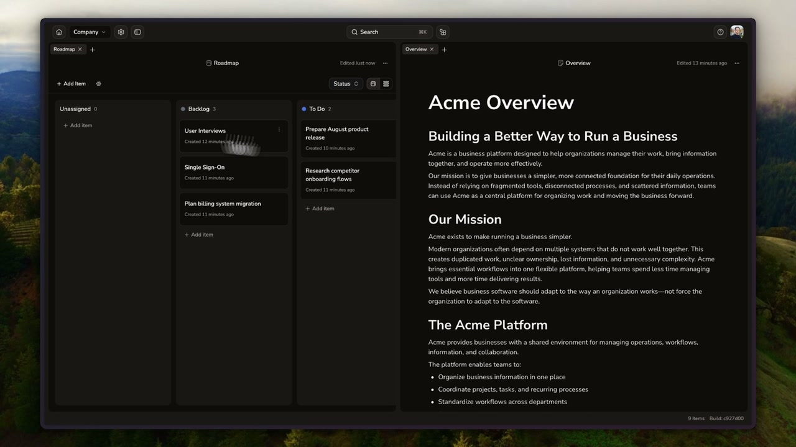

<p align="center">
  <picture>
    <source media="(prefers-color-scheme: dark)" srcset="assets/brand/source/mark-on-dark.svg">
    
  </picture>
</p>

<h1 align="center">Lunaris</h1>

<p align="center"><strong>Your writing. Your workspace. Your way.</strong></p>

<p align="center">
  An offline-first word processor for writing, planning, and working together.<br>
  Keep work on your device, collaborate in real time, and add tools as you need them.
</p>

<p align="center">
  Open-source Community Edition with proprietary enterprise features.
  <a href="#license">Licensing details</a>.
</p>

<p align="center">
  <a href="https://web.lunaris.app">Try Lunaris</a> ·
  <a href="https://lunaris.app">Website</a> ·
  <a href="apps/docs/content/index.mdx">Documentation</a> ·
  <a href="#self-host-lunaris">Self-host</a> ·
  <a href="#contributing">Contribute</a>
</p>

[](https://lunaris.app/watch)

<p align="center">
  <a href="https://lunaris.app/watch"><strong>Watch the 25-second demo</strong></a><br>
  <sub>A silent walkthrough of writing, Kanban boards, drawings, and split views.</sub>
</p>

## A place for ideas to become work

Write offline, collaborate in real time in cloud workspaces, and bring writing,
files, drawings, and tasks together. Add extensions to fit your workflow, connect
your AI tools through MCP, and choose where work lives: on your device, synced
with your team, or on your own server.

## Self-host Lunaris

Run Community Edition on your Linux server:

```sh
curl -fsSL https://lunaris.app/install.sh | bash
```

The installer downloads prebuilt Docker images, generates secrets, and starts
containers for the web app, API, databases, sync, and file storage.

<details>
<summary><strong>Server requirements</strong></summary>

- Linux server with AMD64 or ARM64 CPU and at least 4 GB RAM
- Docker Engine with Docker Compose 2.24+, curl, and OpenSSL
- Domain pointing to your server and open TCP ports 80/443

</details>

<details>
<summary><strong>Unattended installation and options</strong></summary>

Pass your public URL to skip the domain prompt:

```sh
curl -fsSL https://lunaris.app/install.sh | bash -s -- https://notes.example.com
```

Append options after `bash -s --`:

| Argument | Purpose |
| --- | --- |
| `https://notes.example.com` | Public URL; required on first install without a terminal |
| `--dir /path/to/lunaris` | Installation directory (default: `./lunaris`) |
| `--tls-mode external` | Use your HTTPS reverse proxy; serve HTTP on localhost port 8080 |
| `--no-web` | Omit the web frontend; requires your own HTTPS proxy and backend routing |

To pin a release, use `https://lunaris.app/install.sh?version=<version>`.

</details>

See the [self-hosting guide](infra/self-host/README.md) for configuration, backups,
upgrades, and proxy setup, or the [edition guide](ee/README.md#build-selection)
for licensed enterprise builds.

## Build on Lunaris

Extensions add resource types, resource views, and workspace tools. Build tools
for your own workflow using the public packages:

| Package | Purpose |
| --- | --- |
| [`@lunarisapp/plugin-sdk`](packages/plugin-sdk) | Extension contracts and host capabilities |
| [`@lunarisapp/ui`](packages/ui) | Shared UI components for Lunaris extensions |

Start with the [extension quickstart](apps/docs/content/developers/extensions/quickstart.mdx),
explore the [bundled extensions](extensions), or
[connect an AI client through MCP](apps/docs/content/developers/mcp.mdx).
Looking for something to build? Browse [Requests for extensions](https://github.com/LunarisApp/extensions/tree/main/requests)
for open contribution briefs and a proposal template.

## Contributing

See [local development](DEVELOPMENT.md) for setup and
[contributing guidelines](CONTRIBUTING.md) for issues and pull requests.
Report vulnerabilities through the [security policy](SECURITY.md).

## License

First-party source is licensed under [MIT](LICENSE), except where a
separate license is specified. This is a mixed-license repository:

- **Enterprise Edition:** [`ee/`](ee/README.md) is excluded from MIT
  and uses a separate [proprietary license](ee/LICENSE). Builds default to
  Community Edition; explicitly selecting Enterprise Edition requires the
  applicable permission.
- **Landing website:** `apps/landing` includes Tailwind Plus components and
  templates. Those components, templates, and code or assets derived from them
  are **excluded from MIT** and remain subject to the
  [Tailwind Plus license](apps/landing/LICENSE.md), including after modification.
  They are included as part of the Lunaris website, not offered as a reusable
  template, starter kit, or component library. See the
  [landing licensing notes](apps/landing/README.md#licensing) before reusing them.
- **CLI distribution:** source and binaries use [MIT](apps/cli/LICENSE);
  distributed archives also include dependency notices.
- **Other third-party material:** its own licenses and notices continue to apply.

See [third-party notices](THIRD-PARTY-NOTICES.md) for attribution and release checks.
